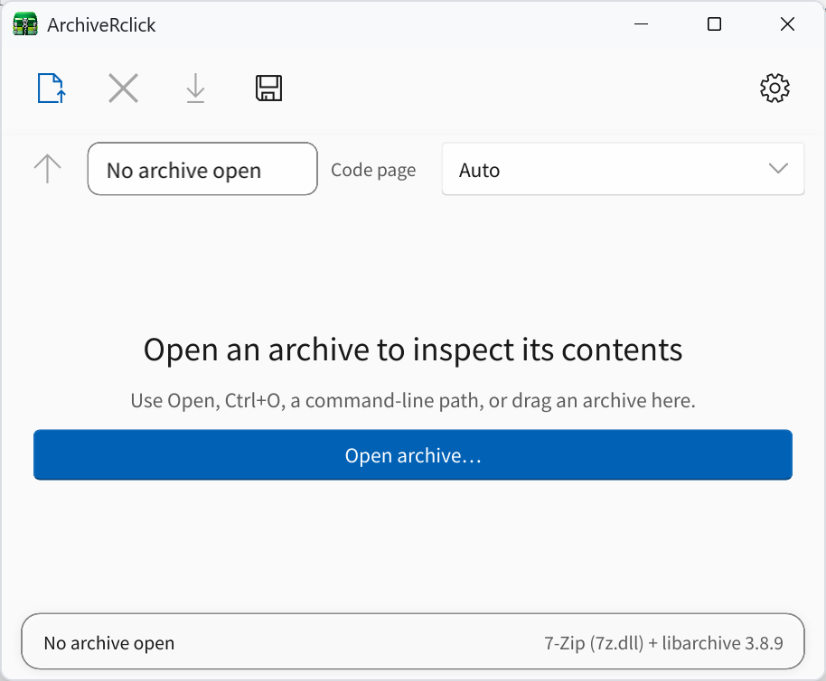

# ArchiveRclick

<p align="center">
  
</p>

ArchiveRclick is a small, portable Windows x64 archive manager written in Rust.
It uses Slint for the native UI, zlib-rs for ZIP creation/extraction by default,
bundled 7-Zip (`7z.dll`) for 7z and fallback ZIP operations, and libarchive for
broader archive-format support.



<a href="https://slint.dev/"></a>

## Features

- Open and browse ZIP, 7z, RAR/RAR5, TAR, CAB, ISO/IMG, LHA/LZH, CPIO, AR, XAR,
  WARC, and more.
- Create ZIP or 7z archives with compression level, thread count, and password
  protection (7z can also encrypt file names), plus split volumes.
- Drag and drop: drag entries out to extract, drop an archive to open it, or
  drop files/folders to start a new archive.
- Optional Explorer right-click commands for extraction and archive creation
  (single or one per folder).
- English/Korean/Japanese UI, system/light/dark themes, configurable fonts and
  legacy filename code pages.
- Settings: selectable ZIP backend (**7z**, **zlib-ng**, **zlib-rs** (default))
  and optional Zone.Identifier propagation to extracted files (on by default).

## Download

Download the portable ZIP from the [Releases page](https://github.com/kirinonakar/ArchiveRclick/releases).

- [Microsoft Store](https://apps.microsoft.com/detail/9PDZJM0TSVPK?hl=ko-kr&gl=KR&ocid=pdpshare) version supports the modern Windows right-click menu.

## Requirements

- 64-bit Windows 10 or 11.
- Rust 1.92 or newer with the MSVC Windows target for building.

The supported libarchive 3.8.9 runtime and its codec dependencies are bundled;
no separate archive-runtime installation is required.

## Build and use

```powershell
cargo build --release
target\release\archive-rclick.exe example.7z
target\release\archive-rclick.exe --check-runtime
```

The Explorer DLL must be built separately with panic unwinding enabled:

```powershell
cargo build --profile shell --lib --locked
```

Use `target\shell\archive_rclick_core.dll` for shell registration. Both packaging
scripts build and include this DLL automatically; the applications retain the
release abort strategy. Shell COM entry points contain unwinding panics, fail the
call, and keep a failed extension loaded and disabled for that host session.

The build copies the required native DLLs and runtime notices beside the
executable. Keep them together when copying the application. To create a clean
portable package with hashes and complete license files, run:

```powershell
.\package-release.ps1
```

Command-line operations:

The console executable `archive-rclick-cli.exe` uses the same archive engines
with 7-Zip-style `a`, `x`, `e`, `l`, and `t` commands. See [CLI.md](CLI.md)
for examples and compatibility limits. `package-msix.ps1` packages both the
GUI and CLI together in `dist/msix`.

GUI/shell command-line operations:

```text
ArchiveRclick [archive|command]
  extract <archive>...  Extract each archive into its own subfolder
  zip <path>...         Create one ZIP archive
  7z <path>...          Create one 7z archive
  zip-each <folder>...  Create one ZIP archive per folder
  7z-each <folder>...   Create one 7z archive per folder
  --register            Register as an available Windows archive handler
  --unregister          Remove that registration
```

`--register` only adds a per-user handler that can be selected under Windows
Default apps; it does not replace the user's existing defaults. The Explorer
right-click extension can be registered or removed from the application's
Settings screen.

## Security

Archive paths are treated as untrusted. Extraction stops on absolute paths,
parent traversal (even in unselected entries), and destination reparse points.
Windows-incompatible names, links, and special files are skipped with a warning
and a skipped-entry count by default, consistently across engines. Existing
files and directories are preserved on type conflicts, including blocked parents.
The API's `ExtractOptions.incompatible_names` and `unsupported_entries` policies
support `Skip` (default) and `Fail`; CLI switches are `-incompatible=skip|fail`
and `-links=skip|fail`. Strict libarchive extraction preflights these policies
before creating output. Names are never silently renamed.

When enabled, download-origin metadata (`Zone.Identifier`) is copied to every
extracted regular file, including unknown extensions. Metadata write failures
produce warnings while payload extraction continues. Successful files remain
installed if a later I/O, cancellation, corruption, or traversal error stops
extraction; extraction is not an archive-wide transaction.

Standalone GUI/CLI errors and panic diagnostics are recorded best-effort in
`%LOCALAPPDATA%\ArchiveRclick\Logs\diagnostics.log` (bounded to about 1 MiB).
Release currently uses `panic=abort`, including the shell-extension DLL. Panic
recovery in Explorer requires a separate unwind-enabled shell build with guards
inside every COM callback; the standalone panic hook does not protect Explorer
and is deliberately not installed in its process.

Listing, testing, and extraction apply entry/size limits and verify
destination handles before installing output. `runtime/SHA256SUMS` records the
expected hashes of the bundled native files.

## License and third-party components

ArchiveRclick source code is licensed under the [MIT License](LICENSE).

The portable ZIP is a combined distribution and is not wholly MIT-licensed;
the bundled components listed below retain their own license terms.

The portable Windows build also redistributes these native components under
their own terms:

| Component | Version | License summary |
| --- | --- | --- |
| libarchive | 3.8.9 | Mixed per-file notices, mainly BSD-style |
| zlib | 1.3.2 | zlib license |
| bzip2 | 1.0.8 | bzip2 license |
| XZ Utils / liblzma | 5.8.3 | 0BSD for liblzma; see package notice |
| LZ4 | 1.10.0 | BSD 2-Clause |
| Zstandard | 1.5.7 | BSD or GPLv2 |
| 7-Zip (`7z.dll`) | 26.03 | LGPL with the 7-Zip unRAR restriction and BSD portions |
| Microsoft VC runtime | 14.51.36247.0 | Microsoft Visual Studio REDIST terms |

The complete notices and license texts are included in
[`runtime/THIRD-PARTY-NOTICES.md`](runtime/THIRD-PARTY-NOTICES.md) and
[`runtime/licenses/`](runtime/licenses/). Microsoft redistribution terms are
also listed at the [Visual Studio REDIST page](https://aka.ms/vs/18/redistribution).
Rust dependency license metadata is listed in
[`THIRD-PARTY-LICENSES.md`](THIRD-PARTY-LICENSES.md).

## Architecture

- `src/archive`: archive API, metadata, options, path safety, and native FFI.
- `src/tasks`: cancellation and throttled progress primitives.
- `src/app`: Slint state and command wiring.
- `src/platform`: Windows dialogs, settings, file associations, and Explorer integration.
- `ui`: Slint components.
